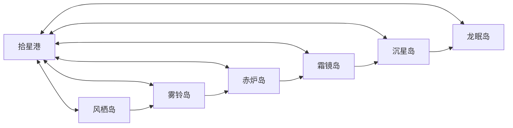

# 星潮海13地图白盒规格

版本starsea-20261003-d1。全部坐标为导航格单位，非屏幕像素。每格32px，等距投影(32,18)。安全港与入口保留至少2格净空，普通通道至少3格净宽，交互点到可行走地面有可达路径。地图使用独立地表与摆件，不以整幅图当作导航地图。

场景代理制作可解析的地图JSON：id、width、height、cellPixels、projection、theme、groundResource、safe、roads、obstacles、landmarks、spawns。spawns明确artId、ruleReference、level、rank和position；不按新外观暗中更换模板或数值。新地图是生产资源与预览数据，本轮不强行注册进旧地区列表。

章节完成后开放下岛，开放岛可以从港直接往返。首领场与准备区为独立地图单元，退出回港规则不被野外安全点替代。

## ss-map-port · 拾星港

- 尺寸：32×32；类型：hub；章节：1。
- 主题：奶白石路、青蓝帆布、暖木与黄铜港具。
- 路线：登陆点(5,25)→登记厅(10,19)→工坊(19,20)→航台(25,10)。
- 地标与交互点：
  - landing：(5, 25)。
  - hall：(10, 19)。
  - forge：(19, 20)。
  - pier：(25, 10)。
- 初始碰撞矩形：
  - (2, 2)，宽8、高6。
  - (16, 3)，宽9、高5。
- 道路在上述锚点间形成可读主路与分支，避开碰撞矩形。代理如发现无法可达，提交具体坐标问题，由主代理修正文档；不能隐藏挪点后声称完全一致。
- 敌人：引用第1章任务与本地/共享兵种，普通/精英/首领档位显式登记。安全登陆与准备区不生成自动追击敌人。
- 深度：建筑底座与前景可拆层；装饰足点排序，树/大屋遮挡不改动碰撞。
- 验收：所有地标可达、两条选择路独立可走、准备区不被遮挡、边界与远景清楚。首领场terminal用于工程后续交互，当前资源预览不宣称任务已完成。

## ss-map-wind · 风栖岛

- 尺寸：64×64；类型：island；章节：1。
- 主题：草坡、港口船台、岛缘与风向布。
- 路线：南港→中部船台→岸线/仓库两路→北首领门。
- 地标与交互点：
  - landing：(8, 56)。
  - clue：(18, 46)。
  - objective：(32, 33)。
  - route-a：(16, 28)。
  - route-b：(47, 30)。
  - gate：(51, 10)。
- 初始碰撞矩形：
  - (4, 34)，宽6、高10。
  - (39, 42)，宽10、高5。
  - (23, 10)，宽6、高7。
- 道路在上述锚点间形成可读主路与分支，避开碰撞矩形。代理如发现无法可达，提交具体坐标问题，由主代理修正文档；不能隐藏挪点后声称完全一致。
- 敌人：引用第1章任务与本地/共享兵种，普通/精英/首领档位显式登记。安全登陆与准备区不生成自动追击敌人。
- 深度：建筑底座与前景可拆层；装饰足点排序，树/大屋遮挡不改动碰撞。
- 验收：所有地标可达、两条选择路独立可走、准备区不被遮挡、边界与远景清楚。首领场terminal用于工程后续交互，当前资源预览不宣称任务已完成。

## ss-map-mist · 雾铃岛

- 尺寸：64×64；类型：island；章节：2。
- 主题：环形林冠、溪谷、邮站与吊桥。
- 路线：南邮站→三线索环路→树冠/溪谷→北军需入口。
- 地标与交互点：
  - landing：(8, 56)。
  - clue-1：(16, 43)。
  - clue-2：(31, 38)。
  - clue-3：(43, 46)。
  - objective：(37, 27)。
  - route-a：(14, 24)。
  - route-b：(50, 28)。
  - gate：(49, 9)。
- 初始碰撞矩形：
  - (22, 46)，宽5、高8。
  - (21, 19)，宽15、高6。
  - (48, 39)，宽5、高10。
- 道路在上述锚点间形成可读主路与分支，避开碰撞矩形。代理如发现无法可达，提交具体坐标问题，由主代理修正文档；不能隐藏挪点后声称完全一致。
- 敌人：引用第2章任务与本地/共享兵种，普通/精英/首领档位显式登记。安全登陆与准备区不生成自动追击敌人。
- 深度：建筑底座与前景可拆层；装饰足点排序，树/大屋遮挡不改动碰撞。
- 验收：所有地标可达、两条选择路独立可走、准备区不被遮挡、边界与远景清楚。首领场terminal用于工程后续交互，当前资源预览不宣称任务已完成。

## ss-map-forge · 赤炉岛

- 尺寸：64×64；类型：island；章节：3。
- 主题：层叠工坊、管线、矿道、铜灰岩与炉火。
- 路线：西港→输能记录→冷却阀→炉顶/矿道→岛心→采能机门。
- 地标与交互点：
  - landing：(7, 52)。
  - clue：(19, 43)。
  - valve-1：(25, 34)。
  - valve-2：(41, 40)。
  - objective：(34, 23)。
  - route-a：(17, 18)。
  - route-b：(49, 25)。
  - gate：(50, 9)。
- 初始碰撞矩形：
  - (5, 26)，宽7、高10。
  - (30, 39)，宽7、高8。
  - (37, 10)，宽6、高6。
- 道路在上述锚点间形成可读主路与分支，避开碰撞矩形。代理如发现无法可达，提交具体坐标问题，由主代理修正文档；不能隐藏挪点后声称完全一致。
- 敌人：引用第3章任务与本地/共享兵种，普通/精英/首领档位显式登记。安全登陆与准备区不生成自动追击敌人。
- 深度：建筑底座与前景可拆层；装饰足点排序，树/大屋遮挡不改动碰撞。
- 验收：所有地标可达、两条选择路独立可走、准备区不被遮挡、边界与远景清楚。首领场terminal用于工程后续交互，当前资源预览不宣称任务已完成。

## ss-map-frost · 霜镜岛

- 尺寸：64×64；类型：island；章节：4。
- 主题：冻舰、白蓝甲板、观测站和冰岩。
- 路线：南冻港→冻舰记录→观测台→舰桥/外壳→星盘→巡守入口。
- 地标与交互点：
  - landing：(10, 56)。
  - clue：(23, 46)。
  - device-1：(17, 31)。
  - device-2：(44, 34)。
  - objective：(31, 24)。
  - route-a：(16, 19)。
  - route-b：(48, 22)。
  - gate：(47, 8)。
- 初始碰撞矩形：
  - (4, 37)，宽9、高8。
  - (28, 33)，宽8、高7。
  - (39, 13)，宽4、高5。
- 道路在上述锚点间形成可读主路与分支，避开碰撞矩形。代理如发现无法可达，提交具体坐标问题，由主代理修正文档；不能隐藏挪点后声称完全一致。
- 敌人：引用第4章任务与本地/共享兵种，普通/精英/首领档位显式登记。安全登陆与准备区不生成自动追击敌人。
- 深度：建筑底座与前景可拆层；装饰足点排序，树/大屋遮挡不改动碰撞。
- 验收：所有地标可达、两条选择路独立可走、准备区不被遮挡、边界与远景清楚。首领场terminal用于工程后续交互，当前资源预览不宣称任务已完成。

## ss-map-rift · 沉星岛

- 尺寸：64×64；类型：island；章节：5。
- 主题：破碎城区、界隙、暮界前哨与灰白难民区。
- 路线：西南港→证词区→炮台/裂隙→三供能器→督军入口。
- 地标与交互点：
  - landing：(8, 55)。
  - clue：(20, 44)。
  - objective：(32, 36)。
  - route-a：(16, 25)。
  - route-b：(48, 30)。
  - device-1：(25, 19)。
  - device-2：(38, 22)。
  - device-3：(44, 15)。
  - gate：(50, 8)。
- 初始碰撞矩形：
  - (6, 29)，宽7、高10。
  - (26, 43)，宽10、高5。
  - (33, 9)，宽5、高6。
- 道路在上述锚点间形成可读主路与分支，避开碰撞矩形。代理如发现无法可达，提交具体坐标问题，由主代理修正文档；不能隐藏挪点后声称完全一致。
- 敌人：引用第5章任务与本地/共享兵种，普通/精英/首领档位显式登记。安全登陆与准备区不生成自动追击敌人。
- 深度：建筑底座与前景可拆层；装饰足点排序，树/大屋遮挡不改动碰撞。
- 验收：所有地标可达、两条选择路独立可走、准备区不被遮挡、边界与远景清楚。首领场terminal用于工程后续交互，当前资源预览不宣称任务已完成。

## ss-map-dragon · 龙眠岛

- 尺寸：64×64；类型：island；章节：6。
- 主题：米金龙骨、青蓝旧航网、断桥与誓约庭。
- 路线：南登陆→龙裔会盟→试炼庭→祭道/机库→三航网节点→提督门。
- 地标与交互点：
  - landing：(10, 55)。
  - clue：(18, 42)。
  - objective：(32, 34)。
  - route-a：(15, 24)。
  - route-b：(49, 28)。
  - device-1：(27, 21)。
  - device-2：(38, 17)。
  - device-3：(45, 22)。
  - gate：(51, 8)。
- 初始碰撞矩形：
  - (5, 32)，宽7、高10。
  - (35, 42)，宽7、高8。
  - (32, 8)，宽5、高5。
- 道路在上述锚点间形成可读主路与分支，避开碰撞矩形。代理如发现无法可达，提交具体坐标问题，由主代理修正文档；不能隐藏挪点后声称完全一致。
- 敌人：引用第6章任务与本地/共享兵种，普通/精英/首领档位显式登记。安全登陆与准备区不生成自动追击敌人。
- 深度：建筑底座与前景可拆层；装饰足点排序，树/大屋遮挡不改动碰撞。
- 验收：所有地标可达、两条选择路独立可走、准备区不被遮挡、边界与远景清楚。首领场terminal用于工程后续交互，当前资源预览不宣称任务已完成。

## ss-map-boss-1 · 暮界先锋·卡珀首领场

- 尺寸：32×32；类型：boss；章节：1。
- 主题：风栖船台。
- 路线：安全准备(5,26)→明确进入(10,22)→首领(18,13)→结束交互(25,7)。
- 地标与交互点：
  - safe：(5, 26)。
  - entrance：(10, 22)。
  - boss：(18, 13)。
  - terminal：(25, 7)。
- 初始碰撞矩形：
  - (3, 7)，宽3、高4。
  - (25, 16)，宽3、高4。
- 道路在上述锚点间形成可读主路与分支，避开碰撞矩形。代理如发现无法可达，提交具体坐标问题，由主代理修正文档；不能隐藏挪点后声称完全一致。
- 敌人：引用第1章任务与本地/共享兵种，普通/精英/首领档位显式登记。安全登陆与准备区不生成自动追击敌人。
- 深度：建筑底座与前景可拆层；装饰足点排序，树/大屋遮挡不改动碰撞。
- 验收：所有地标可达、两条选择路独立可走、准备区不被遮挡、边界与远景清楚。首领场terminal用于工程后续交互，当前资源预览不宣称任务已完成。

## ss-map-boss-2 · 军需官·格铎首领场

- 尺寸：32×32；类型：boss；章节：2。
- 主题：雾铃军需平台。
- 路线：安全准备(5,26)→明确进入(10,22)→首领(18,13)→结束交互(25,7)。
- 地标与交互点：
  - safe：(5, 26)。
  - entrance：(10, 22)。
  - boss：(18, 13)。
  - terminal：(25, 7)。
- 初始碰撞矩形：
  - (3, 7)，宽3、高4。
  - (25, 16)，宽3、高4。
- 道路在上述锚点间形成可读主路与分支，避开碰撞矩形。代理如发现无法可达，提交具体坐标问题，由主代理修正文档；不能隐藏挪点后声称完全一致。
- 敌人：引用第2章任务与本地/共享兵种，普通/精英/首领档位显式登记。安全登陆与准备区不生成自动追击敌人。
- 深度：建筑底座与前景可拆层；装饰足点排序，树/大屋遮挡不改动碰撞。
- 验收：所有地标可达、两条选择路独立可走、准备区不被遮挡、边界与远景清楚。首领场terminal用于工程后续交互，当前资源预览不宣称任务已完成。

## ss-map-boss-3 · 岛心采能机·掘星者首领场

- 尺寸：32×32；类型：boss；章节：3。
- 主题：赤炉核心台。
- 路线：安全准备(5,26)→明确进入(10,22)→首领(18,13)→结束交互(25,7)。
- 地标与交互点：
  - safe：(5, 26)。
  - entrance：(10, 22)。
  - boss：(18, 13)。
  - terminal：(25, 7)。
- 初始碰撞矩形：
  - (3, 7)，宽3、高4。
  - (25, 16)，宽3、高4。
- 道路在上述锚点间形成可读主路与分支，避开碰撞矩形。代理如发现无法可达，提交具体坐标问题，由主代理修正文档；不能隐藏挪点后声称完全一致。
- 敌人：引用第3章任务与本地/共享兵种，普通/精英/首领档位显式登记。安全登陆与准备区不生成自动追击敌人。
- 深度：建筑底座与前景可拆层；装饰足点排序，树/大屋遮挡不改动碰撞。
- 验收：所有地标可达、两条选择路独立可走、准备区不被遮挡、边界与远景清楚。首领场terminal用于工程后续交互，当前资源预览不宣称任务已完成。

## ss-map-boss-4 · 冻舰巡守·霜镜卫首领场

- 尺寸：32×32；类型：boss；章节：4。
- 主题：霜镜冻舰庭。
- 路线：安全准备(5,26)→明确进入(10,22)→首领(18,13)→结束交互(25,7)。
- 地标与交互点：
  - safe：(5, 26)。
  - entrance：(10, 22)。
  - boss：(18, 13)。
  - terminal：(25, 7)。
- 初始碰撞矩形：
  - (3, 7)，宽3、高4。
  - (25, 16)，宽3、高4。
- 道路在上述锚点间形成可读主路与分支，避开碰撞矩形。代理如发现无法可达，提交具体坐标问题，由主代理修正文档；不能隐藏挪点后声称完全一致。
- 敌人：引用第4章任务与本地/共享兵种，普通/精英/首领档位显式登记。安全登陆与准备区不生成自动追击敌人。
- 深度：建筑底座与前景可拆层；装饰足点排序，树/大屋遮挡不改动碰撞。
- 验收：所有地标可达、两条选择路独立可走、准备区不被遮挡、边界与远景清楚。首领场terminal用于工程后续交互，当前资源预览不宣称任务已完成。

## ss-map-boss-5 · 裂隙督军·乌洛首领场

- 尺寸：32×32；类型：boss；章节：5。
- 主题：沉星界桥厅。
- 路线：安全准备(5,26)→明确进入(10,22)→首领(18,13)→结束交互(25,7)。
- 地标与交互点：
  - safe：(5, 26)。
  - entrance：(10, 22)。
  - boss：(18, 13)。
  - terminal：(25, 7)。
- 初始碰撞矩形：
  - (3, 7)，宽3、高4。
  - (25, 16)，宽3、高4。
- 道路在上述锚点间形成可读主路与分支，避开碰撞矩形。代理如发现无法可达，提交具体坐标问题，由主代理修正文档；不能隐藏挪点后声称完全一致。
- 敌人：引用第5章任务与本地/共享兵种，普通/精英/首领档位显式登记。安全登陆与准备区不生成自动追击敌人。
- 深度：建筑底座与前景可拆层；装饰足点排序，树/大屋遮挡不改动碰撞。
- 验收：所有地标可达、两条选择路独立可走、准备区不被遮挡、边界与远景清楚。首领场terminal用于工程后续交互，当前资源预览不宣称任务已完成。

## ss-map-boss-6 · 暮界提督·维洛首领场

- 尺寸：32×32；类型：boss；章节：6。
- 主题：龙眠航网中枢。
- 路线：安全准备(5,26)→明确进入(10,22)→首领(18,13)→结束交互(25,7)。
- 地标与交互点：
  - safe：(5, 26)。
  - entrance：(10, 22)。
  - boss：(18, 13)。
  - terminal：(25, 7)。
- 初始碰撞矩形：
  - (3, 7)，宽3、高4。
  - (25, 16)，宽3、高4。
- 道路在上述锚点间形成可读主路与分支，避开碰撞矩形。代理如发现无法可达，提交具体坐标问题，由主代理修正文档；不能隐藏挪点后声称完全一致。
- 敌人：引用第6章任务与本地/共享兵种，普通/精英/首领档位显式登记。安全登陆与准备区不生成自动追击敌人。
- 深度：建筑底座与前景可拆层；装饰足点排序，树/大屋遮挡不改动碰撞。
- 验收：所有地标可达、两条选择路独立可走、准备区不被遮挡、边界与远景清楚。首领场terminal用于工程后续交互，当前资源预览不宣称任务已完成。

## 导航与资源检查

地图JSON与requirements锚点对照；所有引用资源存在。可复用地表通过真实平铺接缝检查。怪物显示/碰撞比例独立，碰撞数据不能从图片透明边缘推导。坐标变更由主代理登记变更理由并通知物件与集成代理。

